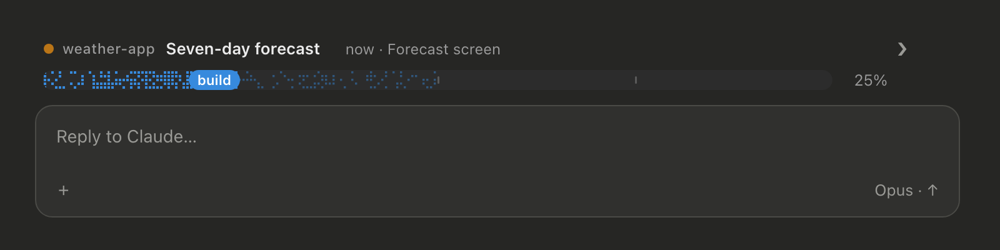
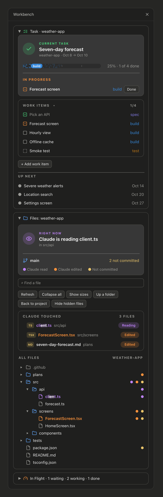
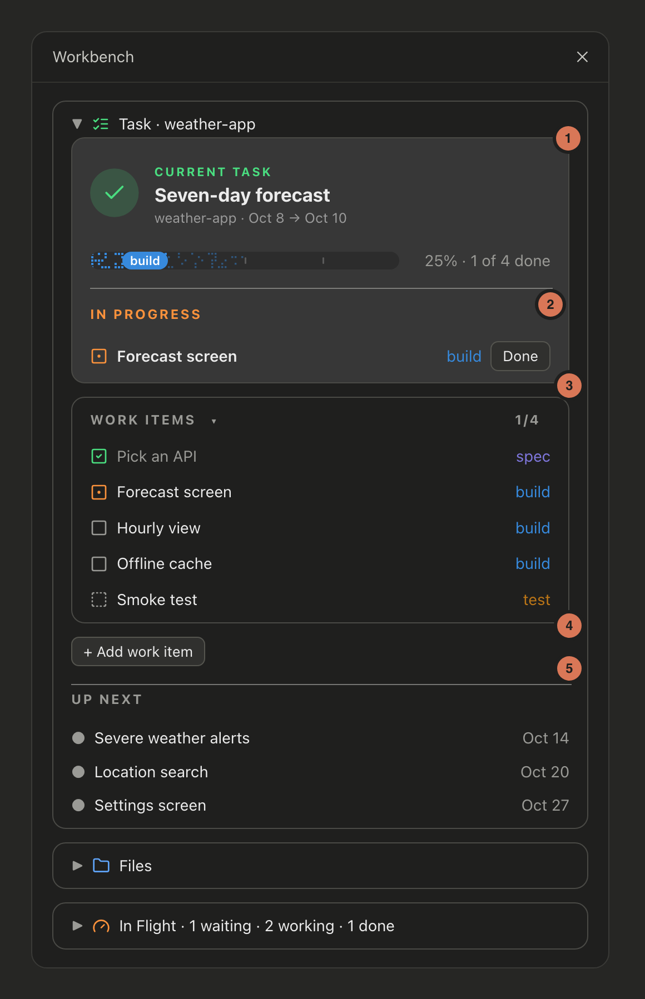
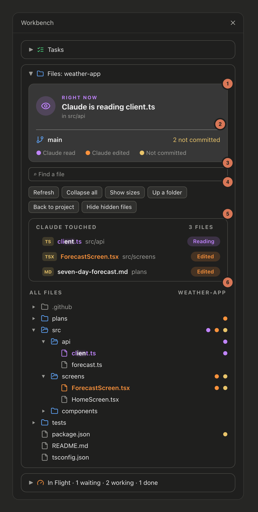
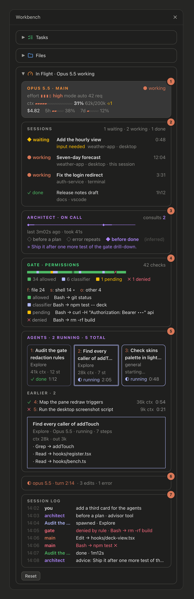

> **Local copy.** This is eascendco/workbench 0.1.30 with local changes, loaded from `~/.claude/mods/workbench` through `CLAUDE_CODE_PLUGIN_DIRS`. Upstream updates do not reach it; pull them in by hand.
>
> - No card borders.
> - In a project with `.claude/plans` or `.claude/docs` (the owner's docs flow), the Tasks box gives way to **For you** (gates waiting, next step, question, open calls), **Plan** (the current plan in `.claude/plans/`: the started one whose log changed last, else the earliest; its phase map, progress from its log's `## Phase N done` and `## Gate X, owner's answer` headings; a phase map row's "Gate B" is a gate, and so is an unnamed "owner gate" (named by its phase number), answered by any gate answer heading after that phase's done heading; every other open plan under Up next with its state), **Tracks**, **Handoffs** and **Research**. `/task` and the `work_items` tool are off there; `/workbench:task` only opens the pane. The band shows the plan and a Workbench button (in place of the arrow) that opens or closes the pane; with no plan (or task) and the pane closed, the button alone. The button always sits at the right end of the band, and what other mods draw in the band (the skins usage band) stays above it. A handoff file that an open plan names as its log ("The handoff log lives at ...") is that plan's log, not an open handoff, even without a `-log` ending. Nothing in `.claude/` is ever written.
> - For you and Tracks come from the current-status skill's report: one Sonnet call at session start (with a surface) and on Refresh, kept in the store. Moved here from the Project status mod.
> - The Files box's branch line adds sync, last fetch, other worktrees and open PRs in those projects.
> - No file tree (nor its Find field and buttons): the Files box keeps Right now and Claude touched. The tree cost about 1,000 characters a row and filled the desktop's 100,000-character limit for a pane; with every box open the pane now stays under 70,000.
> - Research shows five docs a page, each with its track as a pill, and For you's open calls five a page, both with small chevrons to the other pages. Paging keeps these long lists from filling the pane.
> - In Flight has no Sessions panel, Gate (permission checks), Session log or cost: no dollar figure anywhere, and no reading of `~/.claude/sessions` or `ps`. The picture below still shows them (panels 2, 4 and 7, and the cost).
> - In Flight's colors carry meaning, and the skin's orange is not used for the main session: blue while the main session or an agent runs, each gauge (context, 5h, 7d) green below 60%, orange from 60% and red from 85%. The picture below still shows the old orange.
> - In Flight's agents are a list, running first, five a page, with each agent's context (item 5 below); the upstream copy shows the newest three as tiles.
> - Code: `hooks/docs.ts` and `hooks/status.ts` (pure parsing), the rest in `hooks/register.tsx`; tests in `tests/docs.test.tsx`.

# Workbench

A Claude Code mod that keeps your work in view while Claude works. A band above the prompt shows your current task and its progress. A side pane holds three boxes:

- **Tasks:** the current task, its work items and what's up next, kept as plain markdown files in your project.
- **Files:** what Claude is reading or editing right now, your branch and uncommitted changes, every file Claude touched and a file tree.
- **In Flight:** this session's model, context and limits, and your subagents.

No accounts, no services, no network calls.

Works with [claude-skins](https://github.com/hellosverre/claude-skins): the pane takes your skin's colors and follows macOS light and dark. See [Works with skins](#works-with-skins).





<sub>Mockups drawn with the mod's own drawing code and sample data.</sub>

## Install

Needs Claude Code 2.1.287 or later, in a terminal or the desktop app's Code tab.

```
/plugin marketplace add eascendco/workbench
/plugin install workbench@eascend
```

Start a new session and the pane opens. Then start your first task:

```
/task new Seven-day forecast
```

## The pane

Three boxes, each collapsing to one row with its arrow, icon or title. Tasks starts open, Files and In Flight closed, and the pane remembers what you left. The arrow at the end of the band opens and closes the pane. In the desktop app the pane draws icons; in a terminal it uses plain text.

### Tasks

Your current task and what's left on it. See [How tasks work](#how-tasks-work) for the files behind it.



1. **Current task.** Its title, project and dates, and a progress bar in the color of the current stage, with the percent and how many items are done.
2. **In progress.** The items you're working on now. **Done** marks one finished.
3. **Work items.** Every item with its stage. Click an item's square to move it along: draft, to do, in progress, done. The small arrow folds the list.
4. **Add work item.** Type a title, or `stage: title` to pick the stage.
5. **Up next.** The next three open tasks by date.

### Files

What Claude is doing in your project, and the project itself.



1. **Right now.** What Claude is doing this turn: reading or editing a file, running a command, searching, or thinking. Between turns it shows the last file Claude touched.
2. **Branch and changes.** Your git branch and how many files aren't committed, with the key for the dots below.
3. **Find a file.** Searches every file in the project as you type. Enter opens the first match in the tree.
4. **Tree buttons.** Refresh, collapse all, show sizes, go up a folder, go back to the project, show or hide hidden files.
5. **Claude touched.** The last five files Claude read or edited this session, with their folder and whether it's reading or edited them.
6. **All files.** The project tree. Dots mark files Claude read (purple) or edited (orange) and files not yet committed (yellow). A folder shows the dots of what's inside it.

While Claude works, the file it's reading or editing shimmers in the tree and in Claude touched, a band of light sweeping across its name (purple reading, orange editing). Files edited this turn stay lit in orange until your next prompt. A closed folder holding one takes the same color on its icon.

### In Flight

What Claude and its subagents are doing right now, adapted from [claude-flightdeck](https://github.com/scasella/claude-flightdeck) by Stephen Casella (MIT). It only watches: it never blocks or changes a tool call.



1. **Main.** The model, whether it's working, effort, permission mode and requests so far. The context gauge (⟲ counts compactions) and your 5-hour and 7-day limits.
2. **Sessions.** Removed in this copy.
3. **Architect.** Shows up once Claude consults an advisor or architect agent: each consult on a timeline, when it happened (before a plan, after repeated errors, before done; inferred), and the last advice.
4. **Gate.** Removed in this copy.
5. **Agents.** One list, five a page: running agents first (newest first), then finished ones. Two lines each: the task, its status and clock; then type, model and steps, and its context as a small gauge and a number, green / orange / red by how full the agent's window is (the main session's window for the same model, else 200k). Press one to see its last tool calls and the start of its answer under its row. The picture shows the old tiles.
6. **Turn.** The turn in progress with its clock, edits and errors, or a receipt for the last one.
7. **Session log.** Removed in this copy.

Panels with nothing to show take no room, and **Reset** clears the box. It reads its data only while open.

## How tasks work

Each task is one file in `plans/` at your project root. `/task new <title>` writes one for you:

```markdown
---
task: seven-day-forecast
project: weather-app
short: weather-app
title: Seven-day forecast
date: 2026-10-08
end: 2026-10-08
status: open
---

# Seven-day forecast

## Work items

- [x] Pick an API `spec`
- [~] Forecast screen `build`
  Seven days, with the hourly view behind a tap.
- [ ] Offline cache `build`
- [?] Release build `ship`
```

- `[ ]` to do, `[~]` in progress, `[x]` done, `[?]` a draft waiting for your approval.
- The word in backticks is the stage: `spec`, `design`, `build`, `track`, `test` or `ship`.
- Indented lines under an item are its details.
- The current task is the earliest open plan by `date`. The next three are Up next.
- When every item is done, the plan's `status` becomes `done` and the next task moves up.
- Anything else in the file, like a `## Notes` section, is kept as you wrote it.

Claude gets a `work_items` tool to create tasks, add items and update their status. Ask it to "break this task down" and it adds draft items for you to approve.

## Commands

| Command | What it does |
|---|---|
| `/task` | The current task, its work items and Up next |
| `/task new <title>` | Start a task |
| `/task <n>` | One work item with its details |
| `/task start <n>`, `/task done <n>`, `/task reopen <n>` | Change an item's status |
| `/task approve [n]` | Approve one draft, or all of them |
| `/task add [stage:] title -- details` | Add a work item |
| `/task break` | Ask Claude to draft the work items |
| `/task pane` | Open the side pane |
| `/task <anything else>` | Ask Claude, with the task and its plan file attached |

## Settings

In `/config`, under Workbench:

- **Plans folder:** the folder name for plan files. Default `plans`.
- **Open the pane at start:** `on` or `off`.
- **Band above the prompt:** `on` or `off`.
- **Match macOS light and dark:** `on` keeps Claude Code's theme on light or dark to match macOS, checked every 5 seconds (a daltonized or ANSI variant keeps its kind). `off` leaves the theme alone. Does nothing off macOS.

## Works with skins

Workbench works with [claude-skins](https://github.com/hellosverre/claude-skins) by hellosverre, which restyles the Claude Code transcript. With a skin on, the pane takes its colors from your active skin, light or dark. Without one, the pane uses its own colors.

To add skins:

```
/plugin marketplace add hellosverre/claude-skins
/plugin install skins@hellosverre-mods
```

Skins pick light or dark from Claude Code's theme setting, which the desktop app doesn't change when macOS switches. The Match macOS setting above keeps that setting in step, so the transcript and the pane switch with your Mac, no restart needed.

## What it reads

Your plan files, folder listings for the tree, and `git status` for the branch and changes. In Flight reads the session's own events (tool calls, subagent steps, context and limits) and keeps short summaries for the session only. It reads no other file contents beyond the plan files, makes no network calls, and stores nothing outside your project. Run `claude plugin validate` on this folder to see every call it makes.

## Turn it off

Disable it in `/plugin` under Installed, or:

```
claude plugin disable workbench@eascend
```

## License

MIT. Made by [eascend](https://eascend.co). The In Flight box is adapted from [claude-flightdeck](https://github.com/scasella/claude-flightdeck), MIT, Copyright (c) 2026 Stephen Casella; its notice is in `hooks/deck.ts`.
